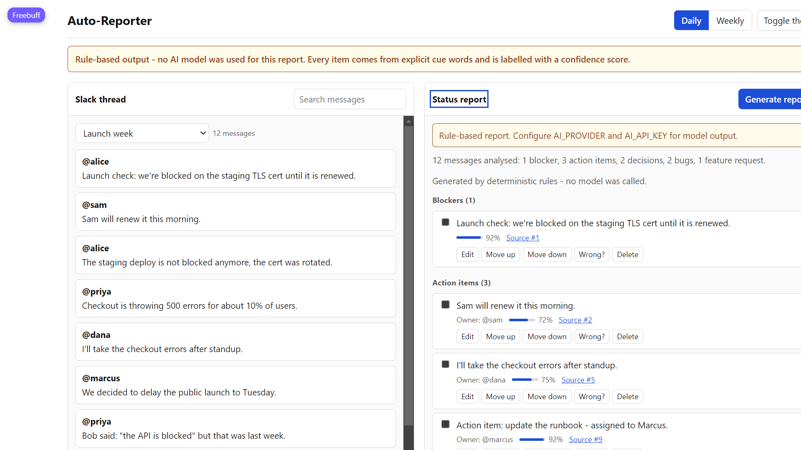
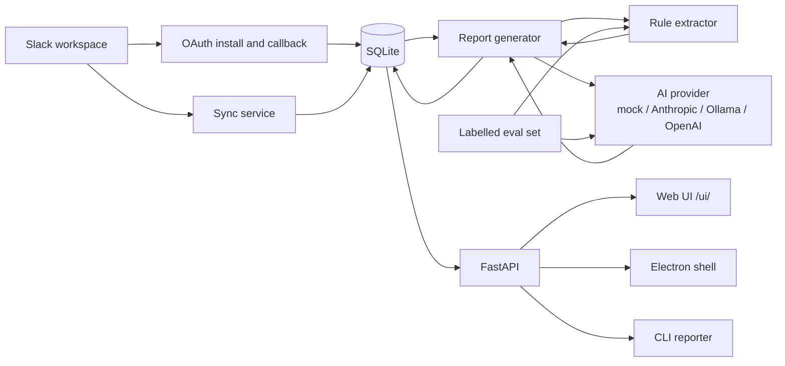

# Auto-Reporter for Slack Teams



Turn a long Slack thread into a status report you can check, correct and share. Auto-Reporter groups blockers, action items, decisions, bugs and feature requests, keeps a link to the message each item came from, and records corrections as evaluation data.

```bash
pip install -r requirements.txt
uvicorn app.main:app --reload
# open http://localhost:8000/ui/ and press Generate report
```

No Slack app or API key is needed for that demo. With the default `AI_PROVIDER=mock` the report comes from a deterministic rule extractor, and the UI says so in a banner instead of passing the output off as model-written.

## Why this exists

Status updates are scattered across long threads, so decisions and blockers get lost between standups. This is for small engineering teams that already talk in Slack and want a report they can verify rather than a summary they have to trust. The difference is that every item carries a confidence score and a source message, the extractor is scored against labelled threads, and the UI records when an item is wrong.

## Status

Only features with an automated test or a recorded check are marked Working.

| Area | Status | Evidence |
| --- | --- | --- |
| FastAPI service | Working | [`tests/test_api.py`](tests/test_api.py) |
| Rule extractor (negation, quotes, owners) | Working | [`tests/test_rule_extractor.py`](tests/test_rule_extractor.py) |
| Labelled evaluation harness | Working | [`tests/test_eval.py`](tests/test_eval.py), [`eval/run_eval.py`](eval/run_eval.py) |
| Demo report API and persistence | Working | [`tests/test_reports_demo.py`](tests/test_reports_demo.py) |
| Done state, edit, reorder, delete items | Working | [`tests/test_reports_demo.py`](tests/test_reports_demo.py) |
| Corrections ("Wrong?") | Working | [`tests/test_reports_demo.py`](tests/test_reports_demo.py) |
| Markdown / Slack / email export | Working | [`tests/test_reports_demo.py`](tests/test_reports_demo.py) |
| Web UI at `/ui/` | Partial | Manually checked in Chromium against the live API; no automated browser test |
| AI providers (Anthropic, Ollama, OpenAI) | Partial | Provider switch and status endpoint exist; only `mock` runs in CI. Ollama was measured separately below |
| Slack OAuth | Partial | [`tests/test_oauth.py`](tests/test_oauth.py); not verified against a live workspace here |
| Slack channel sync | Partial | [`tests/test_slack_service.py`](tests/test_slack_service.py); not verified against a live workspace |
| Send report to Slack | Partial | Missing-token path tested; not sent to a live channel in this environment |
| CLI reporter (`autoreporter/`) | Partial | Runs locally; not covered by CI |
| Electron desktop app | Partial | Shell exists; report generation uses the CLI rule engine, not the FastAPI path |
| Docker | Partial | Dockerfile and compose file exist; not built in this environment |
| Mobile app | Not implemented | Expo scaffold with hardcoded sample data |
| Slack Bolt plugin | Not implemented | Placeholder handlers only |
| Microsoft Teams | Planned | Not started |

## Evaluation

The project ships 25 hand-written Slack threads with per-message labels for blockers, action items, decisions, bugs, feature requests and action-item owners. Labels were written before the first scored run and have not been edited since. `eval/run_eval.py` scores any extractor against them and fails CI if the rules baseline drops below 0.85 precision, 0.60 recall or 0.80 owner accuracy.

The set deliberately includes the cases that break keyword systems: "not blocked anymore", an attributed quote (`Alice said: "the API is blocked"`), a blockquote, inline code containing `500`, "unblocked", a resolved bug, a negated feature request, and a numeric false positive (`We shipped 500 units`).

### Measured comparison

Both rows use the same 25 threads and the same scoring code.

| Method | Blocker precision | Blocker recall | Action item F1 | Micro precision | Micro recall | Owner accuracy |
| --- | --- | --- | --- | --- | --- | --- |
| Rule extractor (default) | **1.00** | 0.75 | **0.92** | **0.94** | 0.79 | **0.86** |
| `llama3.2:latest` via local Ollama | 0.33 | **1.00** | 0.83 | 0.62 | 0.79 | 0.71 |

Per category:

| Category | Rules P | Rules R | Rules F1 | Model P | Model R | Model F1 |
| --- | --- | --- | --- | --- | --- | --- |
| blocker | 1.00 | 0.75 | 0.86 | 0.33 | 1.00 | 0.50 |
| action item | 1.00 | 0.86 | 0.92 | 1.00 | 0.71 | 0.83 |
| decision | 1.00 | 0.75 | 0.86 | 0.75 | 0.75 | 0.75 |
| bug | 0.67 | 0.67 | 0.67 | 1.00 | 0.67 | 0.80 |
| feature request | 1.00 | 1.00 | 1.00 | 1.00 | 1.00 | 1.00 |
| **micro** | **0.94** | **0.79** | **0.86** | **0.62** | **0.79** | **0.70** |

What the numbers say:

- The rule extractor is precision-first. It produced one false positive in 25 threads (the `500 units` sentence) and missed four implicit items that contain no cue words, such as "so we can't start the migration" and "Postgres it is".
- `llama3.2` found every labelled blocker (blocker recall 1.00) but also labelled quoted, negated, decision and bug threads as blockers (8 false positives, blocker precision 0.33). It missed two action items and two of seven owners.
- Neither result justifies calling report generation "production ready". The point of the harness is that this trade-off is visible and re-measurable rather than asserted. A larger hosted model may well score differently; it has not been measured here.

Reproduce:

```bash
python eval/run_eval.py --json                              # rules baseline
python eval/run_model_eval.py --provider ollama \
    --model llama3.2:latest --json                          # live model, needs Ollama
```

Raw results are committed as [`eval/results.json`](eval/results.json) and [`eval/model_results.json`](eval/model_results.json). The model row is a single run on a 3B local model, not an average over seeds, and the sample is 25 synthetic threads. It is evidence about this code path, not a benchmark of any provider.

## AI providers

`GET /api/v1/ai/status` reports the provider that is actually in use. The UI footer and report banner show the same value, so a stub or fallback report is never presented as model output.

| `AI_PROVIDER` | Key required | Default model | Behaviour |
| --- | --- | --- | --- |
| `mock` (default) | No | none | Deterministic rule extraction; no network calls |
| `anthropic` | `AI_API_KEY` | `claude-3-5-sonnet-20241022` | Live Messages API call |
| `ollama` | No | `llama2` | Local OpenAI-compatible endpoint; reports fail if the server is down |
| `openai` | `AI_API_KEY` | `gpt-4o-mini` | OpenAI or compatible endpoint |

If a cloud provider is selected without `AI_API_KEY`, the app does **not** silently call it and does **not** return empty stub data. It falls back to the rule extractor and reports `provider: "mock"` with the reason. The demo endpoint also falls back to rules if a live call fails, and includes a warning in the response.

## Quick start

```bash
git clone https://github.com/Vishwa-manikandan/auto-reporter-slack-teams.git
cd auto-reporter-slack-teams
python -m venv venv
# Windows: venv\Scripts\activate
# macOS/Linux: source venv/bin/activate
pip install -r requirements.txt
cp .env.example .env
uvicorn app.main:app --reload
```

- API: http://localhost:8000
- Web UI: http://localhost:8000/ui/
- Health: http://localhost:8000/health
- OpenAPI docs: http://localhost:8000/docs

Database tables are created on startup. Existing SQLite databases get the new `report_items` columns added by a small SQLite-only migration shim; other databases need a manual migration.

## Configuration

| Variable | Default | Purpose |
| --- | --- | --- |
| `DATABASE_URL` | `sqlite:///./autoreporter.db` | SQLAlchemy connection string |
| `CORS_ORIGINS` | `http://localhost:3000,http://localhost:8000` | Comma-separated allowed origins |
| `DEBUG` | `false` | Debug mode |
| `APP_NAME` | `Auto-Reporter` | Application name |
| `SLACK_BOT_TOKEN` | empty | Bot token for the CLI and Slack posting without OAuth |
| `SLACK_CHANNEL_ID` | empty | Default channel for the CLI and posting |
| `SLACK_CHANNEL_NAME` | empty | Display name in CLI reports |
| `SLACK_API_TIMEOUT` | `30.0` | Slack API timeout, seconds |
| `SLACK_CLIENT_ID` | empty | Slack app client id for OAuth |
| `SLACK_CLIENT_SECRET` | empty | Slack app client secret for OAuth |
| `SLACK_REDIRECT_URI` | empty | Must match the Slack app redirect URL |
| `SLACK_SCOPES` | `channels:read,groups:read,chat:write,users:read` | Requested OAuth scopes |
| `SLACK_SIGNING_SECRET` | empty | Webhook signature verification (not currently exercised) |
| `TOKEN_ENCRYPTION_KEY` | empty | Fernet key for stored Slack tokens |
| `OAUTH_STATE_TTL_SECONDS` | `600` | OAuth state lifetime |
| `AI_PROVIDER` | `mock` | `mock`, `anthropic`, `ollama` or `openai` |
| `AI_API_KEY` | empty | Required for Anthropic/OpenAI |
| `AI_MODEL` | empty | Blank uses the provider default |
| `AI_API_BASE_URL` | empty | Blank uses the provider default |
| `AI_REQUEST_TIMEOUT` | `60` | Model request timeout, seconds |
| `AI_MAX_OUTPUT_TOKENS` | `2048` | Output token cap |
| `AI_RETRY_LIMIT` | `3` | Retry limit setting |

Generate a token encryption key with:

```bash
python -c "from cryptography.fernet import Fernet; print(Fernet.generate_key().decode())"
```

## Slack setup

1. Create an app at [api.slack.com/apps](https://api.slack.com/apps).
2. Add the redirect URL `http://localhost:8000/api/v1/auth/slack/callback` (or your `SLACK_REDIRECT_URI`).
3. Request these scopes if you want sync and posting:

```text
channels:read,channels:history,groups:read,groups:history,chat:write,users:read
```

4. Set `SLACK_CLIENT_ID`, `SLACK_CLIENT_SECRET`, `SLACK_REDIRECT_URI` and `TOKEN_ENCRYPTION_KEY`.
5. Start the server and open `/api/v1/auth/slack/install`.
6. After the callback, tokens are encrypted with Fernet before storage.

Posting a report uses `POST /api/v1/slack/post` with either `report_id` or `text`, plus an optional `channel`. Without a stored workspace token the endpoint returns a 400 explaining how to connect one.

## API

| Method | Path | Purpose |
| --- | --- | --- |
| `GET` | `/health` | Service and database health |
| `GET` | `/api/v1/ai/status` | Effective AI provider, model and fallback reason |
| `POST` | `/api/v1/demo/report` | Generate and persist a report from pasted messages |
| `POST` | `/api/v1/reports/daily` | Generate a daily report from synced Slack messages |
| `POST` | `/api/v1/reports/weekly` | Generate a weekly report from synced Slack messages |
| `GET` | `/api/v1/reports` | List reports |
| `GET` | `/api/v1/reports/{id}` | Report with items |
| `PATCH` | `/api/v1/reports/{id}/items/{item_id}` | Edit text, owner, done state or position |
| `DELETE` | `/api/v1/reports/{id}/items/{item_id}` | Delete an item |
| `POST` | `/api/v1/reports/{id}/items/{item_id}/correction` | Record "wrong" / "ok" feedback |
| `GET` | `/api/v1/reports/{id}/corrections` | List feedback for a report |
| `GET` | `/api/v1/reports/{id}/export?format=` | `markdown`, `slack` or `email` |
| `POST` | `/api/v1/reports/{id}/regenerate` | Regenerate a channel report |
| `DELETE` | `/api/v1/reports/{id}` | Delete a report |
| `GET` | `/api/v1/auth/slack/install` | Start OAuth |
| `GET` | `/api/v1/auth/slack/callback` | OAuth callback |
| `POST` | `/api/v1/auth/slack/revoke` | Revoke tokens |
| `GET` | `/api/v1/slack/status` | Slack connection status |
| `GET` | `/api/v1/slack/channels` | Discover channels |
| `POST` | `/api/v1/slack/channels/select` | Select channels |
| `POST` | `/api/v1/slack/post` | Send a report or text to a channel |
| `POST` | `/api/v1/sync/start` | Start a channel sync |
| `GET` | `/api/v1/sync/status` | Sync status |

## Architecture



- The rule extractor and the AI provider are interchangeable; the report generator records which one produced a report.
- Reports and items are persisted, so done state, edits and ordering survive a refresh.
- Exports are rendered from stored items, not from the model response, so what you share matches what you reviewed.

## Web UI

The UI at `/ui/` is a single dependency-free HTML file. It supports:

- daily/weekly reports from a sample thread or a 220-message thread for scrolling and search checks;
- confidence and source-message links on every item;
- editing, reordering and deleting items before sharing;
- done-state persisted through the API;
- "Wrong?" corrections stored as evaluation data;
- Markdown, Slack-message and email exports;
- posting to Slack once a workspace is connected;
- a provider footer and an unmissable banner when output is rule-based or offline.

When the backend is unreachable the UI keeps working in an "offline demo" mode and says clearly that the output is browser-generated and not saved.

## Data and privacy

- Synced messages, threads, reports, items, corrections and OAuth state are stored in the configured database (SQLite by default).
- Slack tokens are encrypted at rest with Fernet when OAuth is used.
- With `AI_PROVIDER=mock` (the default), no message content leaves the machine.
- With a cloud provider, message content is sent to that provider when a report is generated. The UI shows which provider is active.
- No telemetry is included.

## Testing

```bash
python -m pytest -q                 # 69 tests
python -m ruff check app eval tests # lint baseline
python eval/run_eval.py --json      # rules evaluation and thresholds
```

CI is configured to run all three on pushes and pull requests. No badge is shown yet; a badge should only appear after the workflow has actually gone green on GitHub.

## Limitations and roadmap

- No API authentication or rate limiting; run it on a trusted network.
- SQLite is the tested database. `create_all` plus a SQLite-only column shim is not a migration strategy; Alembic is still a TODO.
- The evaluation covers 25 synthetic threads, one run per method. It is a regression gate, not a benchmark.
- The desktop app still uses the CLI rule engine rather than the FastAPI path.
- Slack OAuth, sync and posting are unit-tested but were not exercised against a live workspace here.
- The Docker and Electron build commands are provided but were not verified in this environment.
- The mobile app, Slack Bolt plugin and Teams integration are not implemented.

Roadmap:

- [ ] Alembic migrations
- [ ] API authentication and per-user isolation
- [ ] Automated browser test for the UI
- [ ] Live-workspace Slack integration test
- [ ] Larger-model evaluation row (Anthropic/OpenAI) under the same harness
- [ ] Unify the desktop app with the FastAPI report path
- [ ] Complete or remove the mobile/plugin scaffolds

## Documentation notes

This README replaces earlier claims that were not supported by the code:

- Removed "Phase 1 Foundation", "All Phases Complete" and "Production deployment ready". There is no production deployment or phase tracking in the repository.
- Downgraded Microsoft Teams, the mobile app and the Slack Bolt plugin from advertised features to Planned/Not implemented; the directories contain scaffolds or placeholders.
- Removed the claim that the desktop app uses the AI backend. It calls the rule-based CLI.
- Removed `BharatCode.txt`. It contained a two-line note and no integration code existed.
- Marked Docker and Electron build commands as unverified rather than presenting them as tested.

## License

MIT. See [LICENSE](LICENSE).
