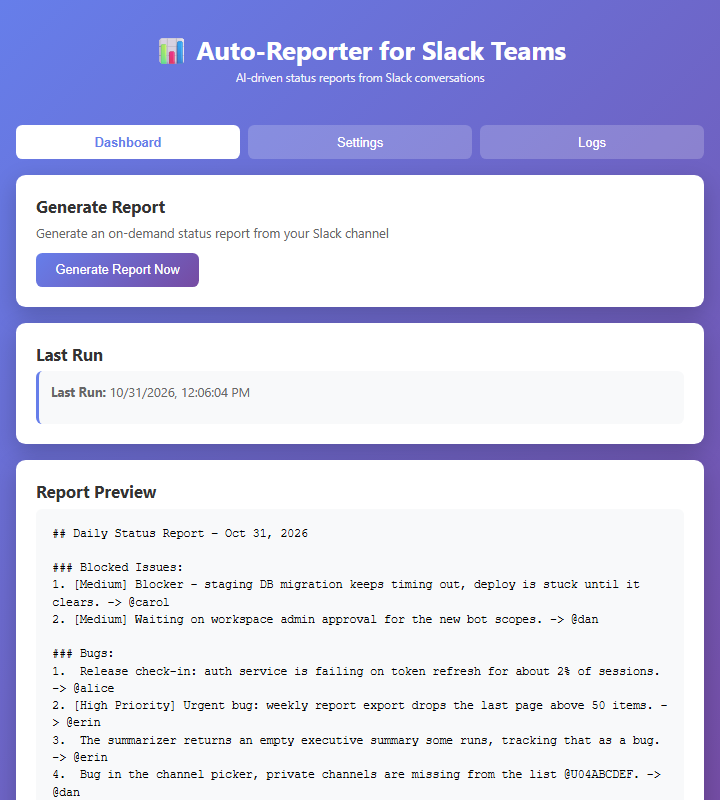
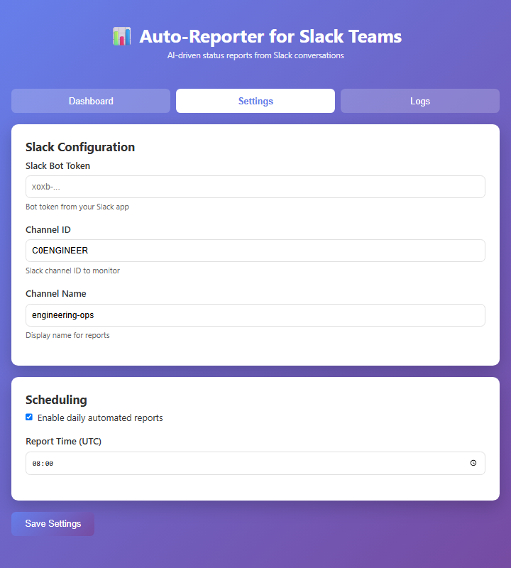
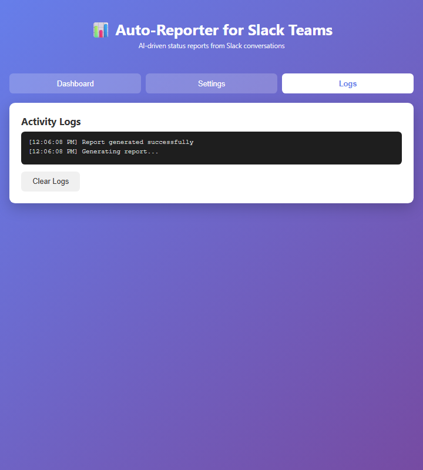
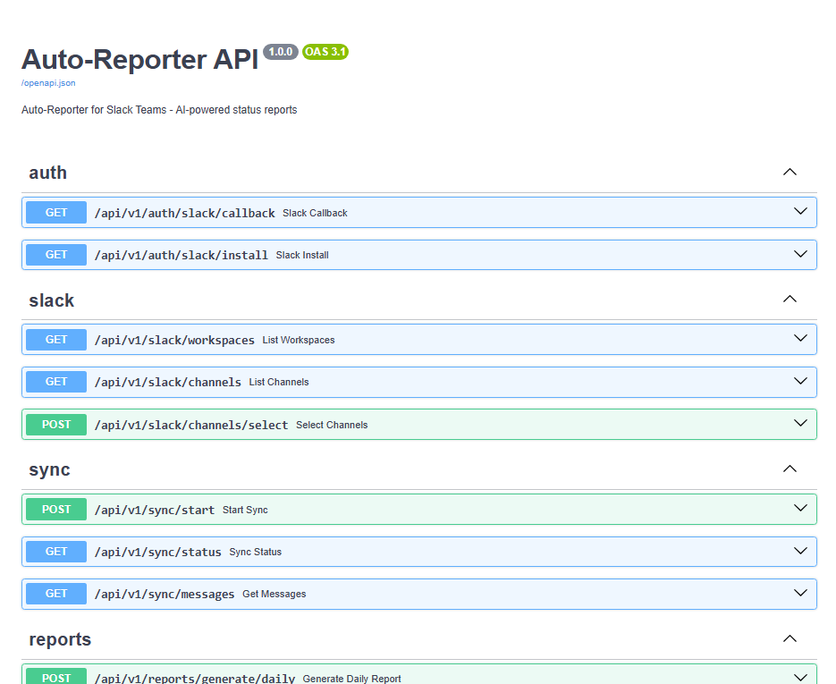
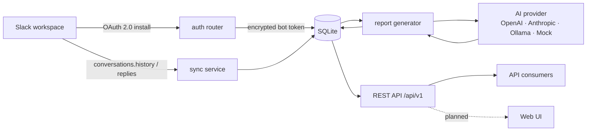

<div align="center">

# Auto-Reporter for Slack Teams

**Turn Slack conversations into structured, actionable team intelligence.**

Auto-Reporter connects to a Slack workspace, synchronises the channels you care about, and turns the day-to-day conversation into daily and weekly reports: decisions, action items, blockers, feature requests and project updates — each traceable back to the messages it came from.

[](LICENSE)
[](https://www.python.org/)
[](https://fastapi.tiangolo.com/)
[](https://github.com/slackapi/python-slack-sdk)
[](https://www.electronjs.org/)

[Installation](#installation) · [Configuration](#configuration) · [AI providers](#ai-providers) · [API reference](#api-reference) · [Testing](#testing) · [Roadmap](#roadmap)



</div>

## Overview

**The problem.** Status lives in Slack threads. Decisions, owners and blockers are scattered across channels and scroll away by the next morning. Writing the weekly update means re-reading everything.

**Who it is for.** Engineering managers, tech leads and project owners who need a reliable written record of what their team decided, what is blocked and what was promised — without asking people to file tickets they will not file.

**What it does.** Auto-Reporter reads selected channels through the Slack Web API, stores the messages and threads locally, and generates structured reports that keep source references. Reports are persisted, listed, regenerated and deleted through the REST API.

**Where AI fits.** A provider abstraction (`app/services/ai_provider.py`) turns conversations into validated structured output: executive summary, decisions, action items, blockers, project updates. Four providers are wired: OpenAI (or any OpenAI-compatible endpoint), Anthropic, Ollama for local models, and a deterministic mock provider used by the tests and by default.

## Screenshots

The three desktop screens are captured from the Electron renderer (`renderer/`) at a consistent 720×800; the API reference is the live Swagger UI served at `/docs`. They show the application's own markup, styles and renderer logic with demo data — the Electron IPC bridge was stubbed because no Slack workspace credentials were available here. No credentials or real messages appear.

| Screen | What it shows |
| --- | --- |
| **Dashboard** | On-demand report generation, last-run timestamp and the rendered report output. |
| **Settings** | Bot token, channel ID and display name, plus the daily scheduled-report controls. |
| **Logs** | In-app activity log written by the renderer while reports run. |
| **API reference** | The live FastAPI OpenAPI documentation served at `/docs`. |


*Dashboard — generating a report and reading the result in place.*



*Settings — Slack target and the optional daily schedule.*



*Logs — what the app did, and when.*



*API reference — every backend route is documented at `/docs`.*

**Not pictured, because no screen exists for it.** The backend's OAuth install flow, channel selection, synchronisation status and daily/weekly report JSON are API-only today — there is no web interface for them, so no screenshot is presented. The Slack OAuth screen is hosted by Slack and requires a live workspace. See [Roadmap](#roadmap).

## Features

Status labels: **Implemented** (works end to end in the code), **Partial** (exists but incomplete or not wired up), **Planned** (not built).

### Slack integration

| Capability | Status | Notes |
| --- | --- | --- |
| Workspace OAuth (install + callback) | Implemented | `app/api/auth.py`; single-use, TTL-bound state tokens |
| Token encryption at rest | Implemented | Fernet (`app/services/encryption_service.py`) |
| Token revocation on disconnect | Implemented | Calls Slack `auth.revoke` |
| Channel discovery and selection | Implemented | Public and private channels, persisted selection |
| Connection health check | Implemented | `auth.test` wrapper |

### Message synchronisation

| Capability | Status | Notes |
| --- | --- | --- |
| Channel history sync | Implemented | `conversations.history` / `conversations.replies` |
| Pagination | Implemented | Cursor-based channel listing; batched history |
| Incremental sync with checkpoints | Implemented | `SyncState` per channel, resumes from last timestamp |
| Retry on transient Slack errors | Implemented | Bounded retries in `app/services/sync_service.py` |
| Deduplication | Implemented | Skips messages already stored |
| Thread reconstruction | Implemented | Parent/reply relationships persisted |

### AI analysis and reporting

| Capability | Status | Notes |
| --- | --- | --- |
| Provider abstraction | Implemented | OpenAI-compatible, Anthropic, Ollama, Mock |
| Mock provider for tests and offline use | Implemented | `AI_PROVIDER=mock`, the default |
| Structured output validation | Implemented | Pydantic schemas |
| Source message references | Implemented | Report items keep message provenance |
| Daily reports | Implemented | `POST /api/v1/reports/generate/daily` |
| Weekly reports | Implemented | `POST /api/v1/reports/generate/weekly` |
| Report history, detail, regenerate, delete | Implemented | `/api/v1/reports` |
| Prompt-injection hardening | Partial | Basic safeguards only |

### Desktop application and tooling

| Capability | Status | Notes |
| --- | --- | --- |
| Electron desktop shell | Partial | `renderer/` + `electron/main.js`; dashboard, settings, logs |
| Report generation from the desktop app | Partial | Shells out to the `autoreporter` CLI, which uses rule-based detection, not the AI providers |
| Daily scheduling | Partial | `node-cron` in the Electron main process |
| Packaged installers | Planned | No `electron-builder` output committed |
| Backend web UI | Planned | Backend exposes REST only |

### Extras

| Capability | Status | Notes |
| --- | --- | --- |
| Slack Bolt app (`packages/slack-plugin`) | Not implemented | `/autoreport` replies with a placeholder string; no backend call yet |
| Mobile app (`packages/mobile`) | Not implemented | Expo screen renders a hardcoded sample report |
| Microsoft Teams integration | Planned | Not started |
| Review, approval and publishing workflow | Planned | Not started |

> **Two report engines exist in this repository.** `app/` (FastAPI) generates reports with an AI provider and persists them. `autoreporter/` is a standalone CLI that produces markdown with keyword rules and no LLM; the Electron app calls that CLI. They are not yet unified.

## How it works



1. **Connect** — install the Slack app and complete OAuth; the bot token is encrypted before storage.
2. **Select** — discover the workspace's channels and mark which ones to follow.
3. **Sync** — fetch history and threads, page through results, store messages, advance the per-channel checkpoint.
4. **Analyse** — the report generator builds a prompt from the stored conversation and calls the configured AI provider.
5. **Generate** — validated output becomes a persisted daily or weekly report with linked report items.
6. **Consume** — read reports through the REST API (and, separately, via the desktop app and CLI).

## Technology stack

| Layer | Technology | Where |
| --- | --- | --- |
| API framework | FastAPI | `app/main.py` |
| Language | Python 3.11 | CI and Docker image |
| ORM / storage | SQLAlchemy 2, SQLite by default (`DATABASE_URL`) | `app/models/`, `app/db/` |
| Validation | Pydantic 2, pydantic-settings | `app/core/`, `app/schemas/` |
| Slack | python-slack-sdk (async WebClient) | `app/services/slack_service.py` |
| Encryption | cryptography (Fernet) | `app/services/encryption_service.py` |
| AI providers | OpenAI-compatible, Anthropic, Ollama, Mock | `app/services/ai_provider.py` |
| Desktop | Electron + vanilla HTML/CSS/JS | `renderer/`, `electron/` |
| Slack app scaffold | Slack Bolt (Node) | `packages/slack-plugin/` |
| Mobile scaffold | Expo / React Native | `packages/mobile/` |
| Tests | pytest, pytest-asyncio | `tests/` |
| Containers | Docker, Docker Compose | `Dockerfile`, `docker-compose.yml` |
| CI | GitHub Actions | `.github/workflows/ci.yml` |

## Installation

**Prerequisites:** Python 3.11 (what CI and the Docker image use), Git. Node.js 18+ only if you want the desktop app or the Slack Bolt scaffold. A Slack workspace where you can install an app.

```bash
git clone https://github.com/Vishwa-manikandan/auto-reporter-slack-teams.git
cd auto-reporter-slack-teams
```

Create and activate a virtual environment:

```bash
# macOS / Linux
python3 -m venv venv
source venv/bin/activate

# Windows (PowerShell or cmd)
python -m venv venv
venv\Scripts\activate
```

Install dependencies and create your environment file:

```bash
pip install -r requirements.txt

# macOS / Linux
cp .env.example .env

# Windows
copy .env.example .env
```

Start the API:

```bash
uvicorn app.main:app --reload
```

* **API root:** <http://localhost:8000>
* **Health check:** <http://localhost:8000/health>
* **Interactive API docs:** <http://localhost:8000/docs>
* **OpenAPI schema:** <http://localhost:8000/openapi.json>

Database tables are created automatically on startup (`Base.metadata.create_all`). There is no migration tooling configured yet, so a schema change means recreating the SQLite file.

### Docker alternative

```bash
docker compose up --build
```

The compose file mounts the repository into the container and runs `uvicorn` with `--reload` on port 8000, using `DATABASE_URL=sqlite:///./autoreporter.db`.

### Desktop app (optional)

The desktop app is a thin Electron shell around `python -m autoreporter`, so it needs both the Node and the CLI dependencies:

```bash
cd packages/desktop
npm install
npm start
```

The CLI imports `click` and `rich`, which are **not** in the root `requirements.txt`. Install them from the core package requirements first:

```bash
pip install -r packages/core/requirements.txt
```

### Command-line reporter (optional)

```bash
export SLACK_BOT_TOKEN=xoxb-...        # Windows: set SLACK_BOT_TOKEN=xoxb-...
export SLACK_CHANNEL_ID=C0123456789

python -m autoreporter --channel C0123456789 --days 1 --output report.md
```

Options: `--channel`, `--token`, `--days` (default 1), `--output`, `--channel-name`. Without `--output` the markdown report is printed to the terminal.

## Configuration

All settings are read from environment variables or `.env` (`app/core/config.py`).

### Core

| Variable | Default | Purpose |
| --- | --- | --- |
| `DATABASE_URL` | `sqlite:///./autoreporter.db` | SQLAlchemy connection string |
| `CORS_ORIGINS` | `http://localhost:3000,http://localhost:8000` | Allowed browser origins |
| `DEBUG` | `false` | Debug flag |
| `APP_NAME` | `Auto-Reporter` | Display name |

### Slack OAuth

| Variable | Purpose |
| --- | --- |
| `SLACK_CLIENT_ID` | App client ID |
| `SLACK_CLIENT_SECRET` | App client secret |
| `SLACK_REDIRECT_URI` | Must match the app's redirect URL exactly, e.g. `http://localhost:8000/api/v1/auth/slack/callback` |
| `SLACK_SCOPES` | Comma-separated bot scopes requested during install |
| `OAUTH_STATE_TTL_SECONDS` | Lifetime of the OAuth state token (default `600`) |

Bot scopes the backend actually calls: `channels:read`, `channels:history`, `groups:read`, `groups:history` (channel listing plus history and replies). The default `SLACK_SCOPES` in `app/core/config.py` also requests `chat:write` and `users:read`; they are harmless but not exercised by the backend yet.

### Slack runtime

| Variable | Purpose |
| --- | --- |
| `SLACK_BOT_TOKEN` | Bot token used by the CLI and by health checks when no workspace is connected |
| `SLACK_CHANNEL_ID` | Default channel for the CLI |
| `SLACK_CHANNEL_NAME` | Display name used in CLI reports |
| `SLACK_SIGNING_SECRET` | Signing secret for webhook verification |
| `SLACK_API_TIMEOUT` | Per-request Slack timeout in seconds (default `30`) |

### Security

| Variable | Purpose |
| --- | --- |
| `TOKEN_ENCRYPTION_KEY` | Fernet key used to encrypt stored bot tokens. Required for OAuth to work. |

Generate one:

```bash
python -c "from cryptography.fernet import Fernet; print(Fernet.generate_key().decode())"
```

Rotating this key invalidates every stored workspace token; reconnect the workspace afterwards.

## AI providers

Set `AI_PROVIDER` to one of `mock`, `openai`, `anthropic` or `ollama`.

| Variable | Purpose |
| --- | --- |
| `AI_PROVIDER` | Active provider; defaults to `mock`, which needs no key or network |
| `AI_API_KEY` | API key for OpenAI-compatible or Anthropic providers |
| `AI_MODEL` | Model name, e.g. `gpt-4o-mini` or a local Ollama model |
| `AI_API_BASE_URL` | Base URL for the API; point it at any OpenAI-compatible gateway |
| `AI_REQUEST_TIMEOUT` | Request timeout in seconds |
| `AI_MAX_OUTPUT_TOKENS` | Maximum tokens per completion |
| `AI_RETRY_LIMIT` | Retries on provider failure |

```bash
# OpenAI or any compatible endpoint
AI_PROVIDER=openai
AI_API_KEY=sk-...
AI_MODEL=gpt-4o-mini
AI_API_BASE_URL=https://api.openai.com/v1

# Anthropic
AI_PROVIDER=anthropic
AI_MODEL=claude-3-5-sonnet-latest

# Local Ollama (no API key)
AI_PROVIDER=ollama
AI_MODEL=llama3
AI_API_BASE_URL=http://localhost:11434
```

Keep keys in `.env` (git-ignored) — never in code or commits.

## API reference

Interactive docs: **<http://localhost:8000/docs>** (Swagger UI) and **<http://localhost:8000/redoc>**.

| Method | Path | Purpose |
| --- | --- | --- |
| `GET` | `/api/v1/auth/slack/install` | Start OAuth; redirects to Slack |
| `GET` | `/api/v1/auth/slack/callback` | OAuth callback; stores the encrypted token |
| `GET` | `/api/v1/slack/status` | Slack connection status |
| `GET` | `/api/v1/slack/workspaces` | List connected workspaces |
| `GET` | `/api/v1/slack/channels` | Discover channels |
| `POST` | `/api/v1/slack/channels/select` | Mark channels as followed |
| `POST` | `/api/v1/sync/start` | Start a sync for a channel or workspace |
| `GET` | `/api/v1/sync/status` | Sync status and checkpoints |
| `GET` | `/api/v1/sync/messages` | Stored messages for a channel |
| `POST` | `/api/v1/reports/generate/daily` | Generate (or reuse) a daily report |
| `POST` | `/api/v1/reports/generate/weekly` | Generate (or reuse) a weekly report |
| `GET` | `/api/v1/reports` | List reports with filters and pagination |
| `GET` | `/api/v1/reports/{report_id}` | Report detail with its items |
| `POST` | `/api/v1/reports/{report_id}/regenerate` | Regenerate an existing report |
| `DELETE` | `/api/v1/reports/{report_id}` | Delete a report |
| `GET` | `/`, `/health` | Service metadata and DB health |

Further reading: [Architecture](docs/ARCHITECTURE.md) · [Slack integration](docs/SLACK_INTEGRATION.md) · [Backend foundation](docs/BACKEND_FOUNDATION.md) · [Git self-healing](docs/GIT_SELF_HEALING.md).

## Testing

```bash
pytest -q
```

**Verified on 2026-10-31** on `refactor/architecture-cleanup`: **34 passed** (warnings only, no failures). The suite covers API routes, configuration, database helpers, models, OAuth state handling, Slack API/service behaviour and the Git recovery service.

**Not verified:** a clean install from a fresh virtual environment on Python 3.11 was not re-run as part of this documentation pass — only the existing interpreter was used. Treat `pip install -r requirements.txt` as untested in a brand-new venv here.

**CI:** `.github/workflows/ci.yml` installs `requirements.txt` on Python 3.11, runs `ruff check .` (non-blocking, `|| true`) and then `pytest -q`. The workflow currently reports **failing** on this branch's latest commit even though the suite passes locally, so the run itself needs investigating before the checks can be trusted as a gate.

## Roadmap

**Completed**

* OAuth workspace connection with encrypted tokens and revocation
* Channel discovery, selection and incremental synchronisation
* AI-backed daily and weekly report generation with persistence
* REST API with report history, regeneration and deletion
* Electron desktop shell with dashboard, settings, logs and scheduling

**Next**

* Align the desktop/CLI rule-based engine with the backend AI report generator
* Web UI for OAuth install, channel selection, sync status and report browsing
* Human review and approval workflow before publishing
* Publishing integrations (Slack, email, exported documents)
* Wire the Bolt app's `/autoreport` command to the backend
* Microsoft Teams integration
* Alembic migrations instead of `create_all`
* Packaged desktop installers

**Explicitly not implemented:** mobile app, Teams, approval/publishing, auth on the API itself (no user accounts — do not expose it publicly as-is).

## Repository layout

```
app/                 FastAPI application (api, services, models, schemas, core, db)
autoreporter/        Standalone CLI reporter (rule-based)
renderer/            Electron renderer: dashboard, settings, logs
electron/            Electron main process
packages/core/       Packaged copy of the CLI + its requirements
packages/desktop/    Duplicate of the Electron app under a workspace package
packages/slack-plugin/ Bolt slash-command scaffold (placeholder responses)
packages/mobile/     Expo/React Native scaffold (hardcoded sample report)
docs/                Architecture, integration and audit notes
docs/images/         Screenshots used in this README
tests/               pytest suite
demo/, eval/         Sample Slack thread and evaluation set
```

> The `autoreporter/`, `electron/` and `renderer/` directories form the working CLI and desktop app. `packages/` contains parallel copies and scaffolds; reconcile them before building on the `packages/` versions.

## Contributing

1. Create a branch from `main`.
2. Keep the change focused; match the existing FastAPI/SQLAlchemy patterns.
3. Run `pytest -q` before committing.
4. Open a pull request describing the change and its verification.

Commit messages follow the existing style: `feat:`, `fix:`, `test:`, `docs:`, `chore:`.

## License

MIT — see [LICENSE](LICENSE).
