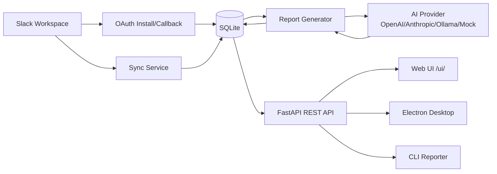

# Auto-Reporter for Slack Teams

AI-driven automation to summarize Slack threads, detect action items and blockers, and generate structured status reports from Slack conversations.

## Status

| Component | State | Notes |
| --- | --- | --- |
| FastAPI backend | Working | Core API routes, models, services are implemented. |
| Slack OAuth integration | Working | OAuth install/callback, token storage with encryption, revocation support. |
| Slack channel sync | Working | Channel discovery, message sync, thread reconstruction, incremental sync with checkpoints. |
| Report generation (AI) | Partial | Provider abstraction exists (OpenAI, Anthropic, Ollama, Mock). Default is Mock. Requires API keys for real providers. |
| Report persistence | Working | Reports and report items stored in SQLite via SQLAlchemy. |
| CLI reporter (`autoreporter/`) | Working | Rule-based keyword detection, standalone CLI. Separate from the AI backend. |
| Electron desktop app | Partial | Basic shell exists; report generation uses the CLI (rule-based), not the AI backend. Scheduling implemented. |
| Web UI (`/ui/`) | Partial | Single-page UI with thread view, report generation with keyword fallback, Slack connection panel. |
| Slack Bolt plugin (`packages/slack-plugin/`) | Not implemented | Placeholder responses only. |
| Mobile app (`packages/mobile/`) | Not implemented | Expo scaffold with hardcoded sample data. |
| Microsoft Teams integration | Planned | Not started. |
| Review/approval/publishing workflow | Planned | Not implemented. |
| Public distribution/packaged installers | Planned | No electron-builder outputs committed. |

## What runs today

- **Backend API**: FastAPI app with routes for auth, Slack, sync, and reports. Runs with `uvicorn app.main:app`.
- **AI**: By default uses `AI_PROVIDER=mock` (returns stub data). Real AI requires configuring `AI_PROVIDER` to `openai`, `anthropic`, or `ollama` with appropriate credentials/endpoint.
- **CLI**: `python -m autoreporter` uses keyword rules only (no LLM). Independent from the FastAPI AI provider.
- **Database**: SQLite by default (`DATABASE_URL=sqlite:///./autoreporter.db`), tables created on startup via `Base.metadata.create_all()`. No migration tooling configured.

**BharatCode**: Referenced in project history as a local model concept; no BharatCode integration code is present in the current codebase. Treat as not implemented.

## Quick start

```bash
# Clone
git clone https://github.com/Vishwa-manikandan/auto-reporter-slack-teams.git
cd auto-reporter-slack-teams

# Create and activate virtual environment
python -m venv venv
# Windows
venv\Scripts\activate
# macOS/Linux
# source venv/bin/activate

# Install dependencies
pip install -r requirements.txt

# Configure environment
cp .env.example .env
# Edit .env with your values

# Run the API
uvicorn app.main:app --reload
```

- API root: http://localhost:8000
- Health: http://localhost:8000/health
- API docs: http://localhost:8000/docs
- Web UI: http://localhost:8000/ui/

## Configuration

All settings come from environment variables (`.env`). See `.env.example` for defaults.

| Variable | Required | Description | Values |
| --- | --- | --- | --- |
| `DATABASE_URL` | No | SQLAlchemy connection string | Default: `sqlite:///./autoreporter.db` |
| `CORS_ORIGINS` | No | Allowed CORS origins (comma-separated) | Default: `http://localhost:3000,http://localhost:8000` |
| `DEBUG` | No | Debug mode | `true`/`false` (default: `false`) |
| `APP_NAME` | No | Application name | Default: `Auto-Reporter` |
| `SLACK_BOT_TOKEN` | No* | Bot token for CLI/health checks | `xoxb-...` (*required for CLI without OAuth) |
| `SLACK_CHANNEL_ID` | No* | Default channel for CLI | Channel ID like `C123...` |
| `SLACK_CHANNEL_NAME` | No | Display name for CLI reports | String |
| `SLACK_API_TIMEOUT` | No | Slack API timeout in seconds | Default: `30.0` |
| `SLACK_CLIENT_ID` | No* | Slack app client ID for OAuth | From Slack app settings |
| `SLACK_CLIENT_SECRET` | No* | Slack app client secret for OAuth | From Slack app settings |
| `SLACK_REDIRECT_URI` | No* | OAuth redirect URI (must match Slack app) | Default: `http://localhost:8000/api/v1/auth/slack/callback` |
| `SLACK_SCOPES` | No | OAuth scopes | Default: `channels:read,groups:read,chat:write,users:read` |
| `SLACK_SIGNING_SECRET` | No | For webhook verification (if used) | From Slack app settings |
| `TOKEN_ENCRYPTION_KEY` | No* | Fernet key for encrypting stored tokens | Generate with `python -c "from cryptography.fernet import Fernet; print(Fernet.generate_key().decode())"` |
| `OAUTH_STATE_TTL_SECONDS` | No | OAuth state token TTL | Default: `600` |
| `AI_PROVIDER` | No | AI provider | `mock` (default), `openai`, `anthropic`, `ollama` |
| `AI_API_KEY` | No* | API key for OpenAI/Anthropic | Required if using those providers |
| `AI_MODEL` | No | Model name | Default varies by provider |
| `AI_API_BASE_URL` | No | API base URL | Default varies by provider |
| `AI_REQUEST_TIMEOUT` | No | Request timeout in seconds | Default: `60` |
| `AI_MAX_OUTPUT_TOKENS` | No | Max output tokens | Default: `2048` |
| `AI_RETRY_LIMIT` | No | Retry limit | Default: `3` |

\* Required for the corresponding features to work.

## Slack setup

### Create a Slack app
1. Go to [api.slack.com/apps](https://api.slack.com/apps) and create a new app.
2. Choose "From scratch", give it a name and select your workspace.

### OAuth scopes
The backend requests the following scopes (see `app/core/config.py` and `app/api/auth.py`):
- `channels:read` - List public channels
- `channels:history` - Read public channel history
- `groups:read` - List private channels
- `groups:history` - Read private channel history

Default `SLACK_SCOPES` in config also includes `chat:write` and `users:read` (not currently exercised by core functionality).

### Redirect URL
Set the redirect URL in your Slack app's OAuth & Permissions to match `SLACK_REDIRECT_URI` (default: `http://localhost:8000/api/v1/auth/slack/callback`).

### Install
1. Set `SLACK_CLIENT_ID`, `SLACK_CLIENT_SECRET`, `SLACK_REDIRECT_URI`, and `TOKEN_ENCRYPTION_KEY` in `.env`.
2. Start the server and visit `/api/v1/auth/slack/install` to begin OAuth flow.
3. After installation, tokens are encrypted and stored in the database.

## AI providers

| Provider | Type | Requirements | Notes |
| --- | --- | --- | --- |
| `mock` | Stub (default) | None | Returns placeholder structured data. Used in tests and as fallback. |
| `openai` | Cloud | `AI_API_KEY`, optional `AI_MODEL`, `AI_API_BASE_URL` | OpenAI or OpenAI-compatible endpoints. |
| `anthropic` | Cloud | `AI_API_KEY`, optional `AI_MODEL` | Anthropic API. |
| `ollama` | Local | `AI_MODEL`, `AI_API_BASE_URL` (e.g., `http://localhost:11434/v1`) | Runs against local Ollama instance. |

If no API key is configured and provider is not explicitly set to mock, the factory falls back to mock.

## API endpoints

Interactive docs available at `/docs` and `/redoc` when the server is running.

| Method | Path | Purpose |
| --- | --- | --- |
| `GET` | `/` | Service info |
| `GET` | `/health` | Health check (DB status) |
| `GET` | `/api/v1/auth/slack/install` | Start OAuth flow |
| `GET` | `/api/v1/auth/slack/callback` | OAuth callback |
| `POST` | `/api/v1/auth/slack/revoke` | Revoke tokens |
| `GET` | `/api/v1/auth/slack/status` | Auth status |
| `GET` | `/api/v1/slack/status` | Slack connection status |
| `GET` | `/api/v1/slack/workspaces` | List workspaces |
| `GET` | `/api/v1/slack/channels` | Discover channels |
| `POST` | `/api/v1/slack/channels/select` | Select channels |
| `POST` | `/api/v1/sync/start` | Start sync |
| `GET` | `/api/v1/sync/status` | Sync status |
| `GET` | `/api/v1/sync/messages` | Get stored messages |
| `POST` | `/api/v1/reports/daily` | Generate daily report |
| `POST` | `/api/v1/reports/weekly` | Generate weekly report |
| `GET` | `/api/v1/reports` | List reports |
| `GET` | `/api/v1/reports/{report_id}` | Get report details |
| `POST` | `/api/v1/reports/{report_id}/regenerate` | Regenerate report |
| `DELETE` | `/api/v1/reports/{report_id}` | Delete report |

## Docker

### Build and run
```bash
docker compose up --build
```

The compose file mounts the repo and runs `uvicorn app.main:app --host 0.0.0.0 --port 8000 --reload` with `DATABASE_URL=sqlite:///./autoreporter.db`. Exposes port 8000.

### Dockerfile
Uses `python:3.11-slim`, installs from `requirements.txt`, copies the app, runs uvicorn on port 8000.

## Architecture



- **Slack integration**: OAuth, channel discovery, message history sync with pagination and checkpoints.
- **Storage**: SQLAlchemy models for workspaces, channels, messages, sync state, reports, report items.
- **AI**: Provider abstraction with pluggable backends; defaults to mock.
- **Reports**: Generated from stored messages, persisted with items and metadata.
- **Interfaces**: REST API, web UI, Electron desktop app, CLI tool.

## Data and privacy

- **Stored data**: Slack messages, threads, channel info, workspace info, sync state, reports, report items. Stored in local SQLite by default.
- **Tokens**: Bot tokens encrypted at rest using Fernet when OAuth is used. Encryption key via `TOKEN_ENCRYPTION_KEY`.
- **AI provider**: If using cloud providers, message content may be sent to the configured provider. With `mock`, no external calls are made. Users are responsible for API key security.
- **Local-first**: Default configuration keeps data local; no telemetry included.

## Limitations and roadmap

### Limitations
- No database migrations (uses `create_all()`; schema changes require recreating DB).
- AI defaults to mock; real AI requires external API keys or local Ollama.
- Desktop app uses CLI (rule-based) rather than the AI backend.
- Web UI has limited integration with backend report generation (falls back to keyword rules).
- Mobile app and Slack Bolt plugin are scaffolds/placeholders.
- No user authentication on API (designed for local/trusted environments).
- Microsoft Teams not implemented.

### Roadmap
- [ ] Alembic migrations
- [ ] Unify desktop app with FastAPI AI backend
- [ ] Enhance web UI to fully use backend APIs
- [ ] Complete Slack Bolt plugin integration
- [ ] Add review/approval/publishing workflow
- [ ] Improve security (API auth, rate limiting)
- [ ] Package desktop app installers

## Testing

```bash
pytest -q
```

Run from the repository root. Tests cover API routes, configuration, database, models, OAuth, Slack services, and Git recovery.

## License

MIT License - see [LICENSE](LICENSE) for details.
